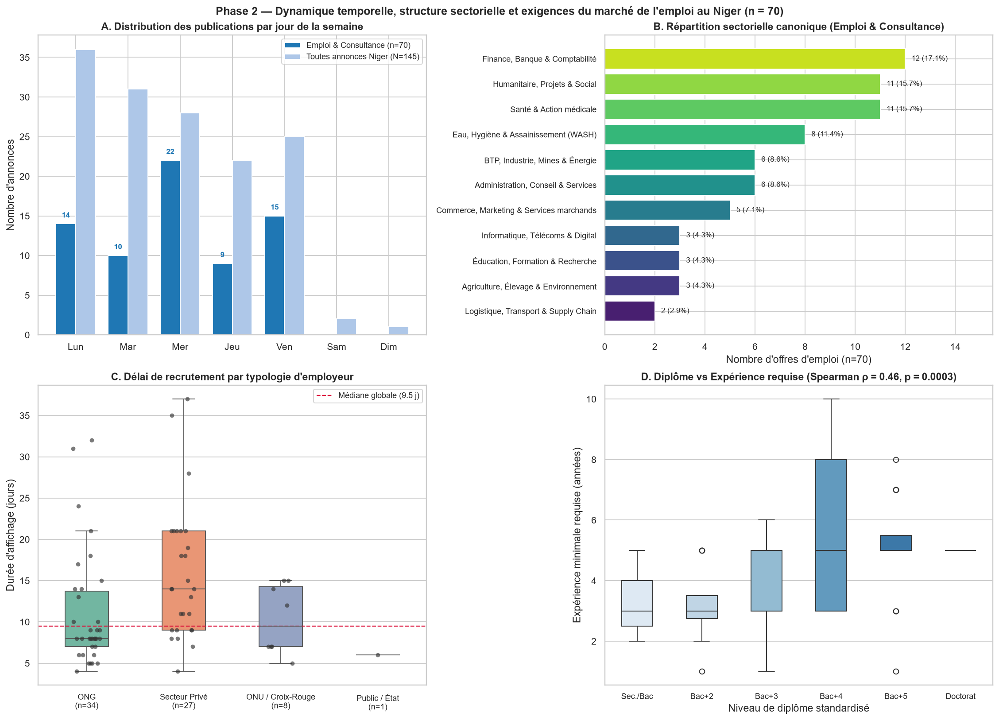
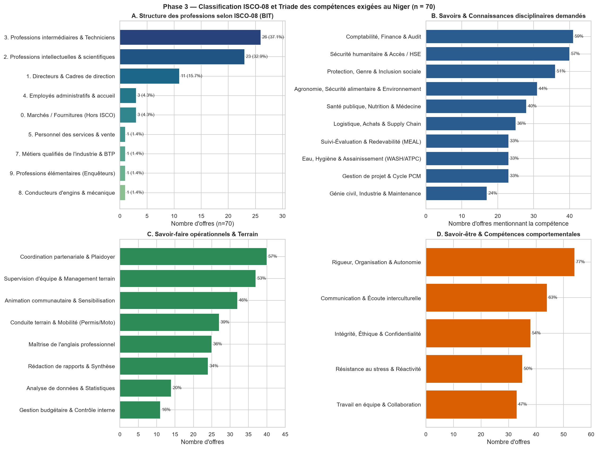
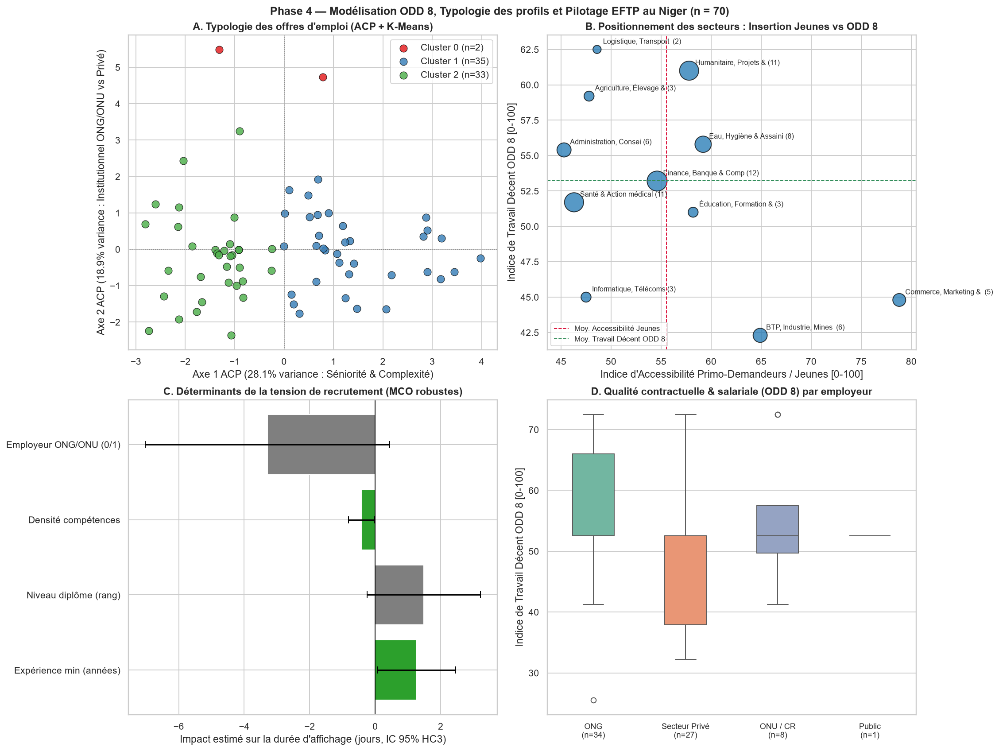

# Le marché de l’emploi formel au Niger

## Demande de travail, qualité de l’emploi et compétences recherchées

Cette étude propose une lecture accessible des offres d’emploi et de consultance publiées en ligne au Niger. Elle met en lumière les profils recherchés, les conditions d’emploi affichées et les compétences qui peuvent guider les formations et l’accompagnement vers l’emploi.

> **En bref :** 70 offres d’emploi et de consultance analysées, sur un corpus de 145 annonces uniques localisées au Niger.

## Objectif

Donner aux établissements de formation, aux chercheurs d’emploi, aux recruteurs et aux décideurs des repères simples sur la demande de compétences du marché formel en ligne au Niger.

## Périmètre et méthodologie

L’analyse porte sur des annonces publiées entre **août et novembre 2026**. Cette synthèse présente les principaux résultats sans détailler les choix techniques. Le protocole, les définitions et les limites sont décrits dans le [rapport méthodologique complet (PDF)](Rapport%20Final/rapport_m_thodologique_et_analytique_march_de_l_emploi_formel_au_niger.pdf).

Les plateformes consultées comprennent notamment [ANPE Niger](https://anpe-niger.ne/offres-demploi/), [Niger Emploi](https://www.nigeremploi.com/emplois-annonces.html), [Niger Job](https://www.nigerjob.net/recherche-jobs-niger) et [Niger Carrière](https://connexion-carriere.com/offres-demplois/).

## Le corpus en quelques chiffres

| Étape / catégorie | Nombre | Lecture simple |
|---|---:|---|
| Pages brutes collectées | 368 | Pages examinées au départ |
| Annonces initiales | 171 | Annonces repérées après une première sélection |
| Annonces uniques au Niger | 145 | Emploi, marchés et formations confondus |
| Emploi et consultance | 70 | Sous-ensemble utilisé pour les principaux résultats |
| Marchés et appels d’offres | 59 | Distingués des offres d’emploi |
| Avis de formation | 16 | Annonces de sessions et de formations |

## Principaux résultats

### Qui recrute ?

| Résultat | Part des 70 offres | Interprétation |
|---|---:|---|
| ONG | 48,6 % | Près d’une offre sur deux |
| Secteur privé et cabinets | 38,6 % | Un peu moins de quatre offres sur dix |
| ONU et Croix-Rouge | 11,4 % | Une part plus restreinte |
| Public et État | 1,4 % | Une offre dans le corpus |

Les domaines les plus représentés sont la **finance, la banque et la comptabilité (17,1 %)**, la **santé (15,7 %)**, l’**humanitaire et le social (15,7 %)**, ainsi que l’**eau, l’hygiène et l’assainissement (11,4 %)**. Ces quatre domaines réunissent 60 % des offres étudiées.

### Contrats, rémunération et délais

| Indicateur | Résultat | À retenir |
|---|---:|---|
| CDD | 71,4 % | Le type de contrat le plus fréquent |
| Prestation ou consultance | 14,3 % | Environ une offre sur sept |
| Contrat non précisé | 7,1 % | Les modalités ne sont pas toujours indiquées |
| CDI | 2,9 % | Peu d’offres mentionnent un CDI |
| Stage | 2,9 % | Peu d’offres sont explicitement des stages |
| Bénévolat | 1,4 % | Une part marginale |
| Offres affichant un salaire chiffré | 0 % | Aucune des offres analysées ne publie de montant précis |
| Opacité salariale totale | 78,6 % | La rémunération ou ses repères restent souvent peu documentés |
| Délai médian de candidature — ONG | 8 jours | Les délais sont particulièrement courts |
| Délai médian de candidature — secteur privé | 14 jours | La fenêtre de candidature est plus longue dans cet échantillon |

**Toutes les offres de l’échantillon ont été publiées en semaine**; le **mercredi** est le jour le plus fréquent (31,4 %). Le diplôme demandé et l’expérience requise tendent aussi à augmenter ensemble dans les offres observées. Les délais médians diffèrent entre ONG et secteur privé dans l’échantillon, mais ces résultats décrivent ces offres et ne préjugent pas de tous les recrutements au Niger.

### Métiers et compétences recherchées

| Compétence ou famille de métiers | Part des offres | Interprétation |
|---|---:|---|
| Professions intermédiaires et techniciens | 37,1 % | Les profils opérationnels sont très présents |
| Professions intellectuelles et scientifiques | 32,9 % | Une part importante de postes qualifiés |
| Rigueur, organisation et autonomie | 77,1 % | La qualité comportementale la plus souvent citée |
| Communication et écoute interculturelle | 62,9 % | Une compétence transversale importante |
| Comptabilité, finance et audit | 58,6 % | Le savoir spécialisé le plus fréquent |
| Coordination et plaidoyer | 57,1 % | Un savoir-faire souvent demandé |
| Pack MS Office et Excel | 35,7 % | L’outil le plus fréquemment cité |

Les compétences comportementales et pratiques complètent donc les diplômes et les connaissances métier. Les pourcentages de compétences ne s’additionnent pas : une même annonce peut en demander plusieurs.

### Indices synthétiques de l’étude

| Indice construit pour l’étude | Moyenne sur 100 | Lecture simple |
|---|---:|---|
| Travail décent | 53,2 | Niveau intermédiaire dans les informations observées |
| Accessibilité aux jeunes et primo-demandeurs | 55,5 | Ouverture modérée aux profils débutants |
| Tension et sélectivité des postes | 36,0 | Indice synthétique des exigences et délais |

Ces indices sont des outils d’analyse élaborés pour cette étude, et non des statistiques officielles.

## Figures et interprétations

### Figure 1 — Calendrier, secteurs et caractéristiques des offres

*Lecture : la figure compare les jours de publication, les secteurs, les délais de candidature selon le type d’employeur et l’expérience demandée selon le niveau de diplôme.*

### Figure 2 — Métiers et compétences recherchées

*Lecture : les profils intermédiaires et qualifiés sont nombreux; rigueur, communication, finance et coordination figurent parmi les compétences fréquemment citées.*

### Figure 3 — Travail décent, accessibilité et profils d’offres

*Lecture : la figure rassemble les indices de l’étude, une typologie exploratoire des offres et les associations observées avec la durée de publication. Les groupes doivent être lus avec prudence compte tenu du nombre d’offres.*

## Recommandations

1. **Adapter les formations aux besoins observés :** renforcer les compétences métier en finance, santé, humanitaire et WASH, ainsi que la communication, la coordination et les outils numériques.
2. **Faciliter l’accès des jeunes à une première expérience :** développer stages encadrés, alternance et projets pratiques pour rapprocher formation et exigences des recruteurs.
3. **Améliorer la transparence des offres :** encourager la publication des salaires ou, à défaut, des grilles, niveaux et avantages associés aux postes.
4. **Élargir l’observation du marché :** suivre les offres sur une période plus longue et compléter les annonces en ligne avec des sources couvrant l’emploi informel et les recrutements hors plateformes.

## Limites à garder en tête

Ces résultats décrivent les offres publiées en ligne pendant une période limitée; ils ne représentent pas l’ensemble du marché du travail nigérien. L’emploi informel et les recrutements qui ne passent pas par les plateformes sont notamment peu observés. Les associations statistiques présentées ne démontrent pas, à elles seules, un lien de cause à effet.
